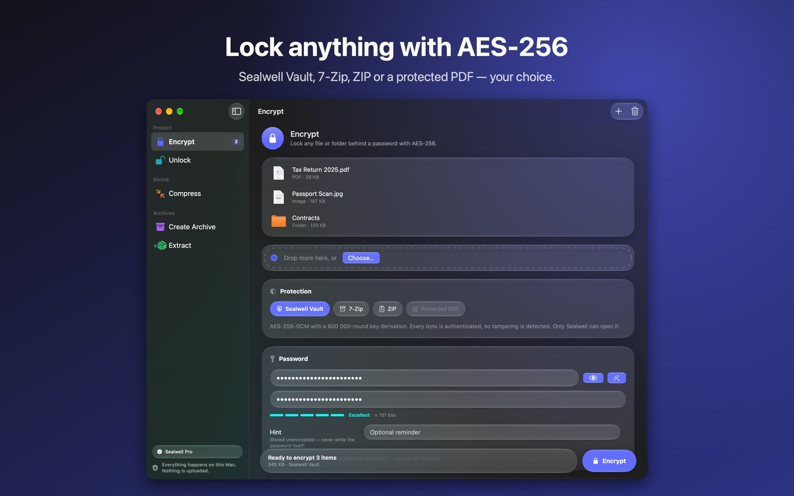

# Sealwell

Encrypt, compress and archive any file on your Mac, without sending anything anywhere.

**Mac App Store: coming soon** · [Website](https://perseus-sepahi.github.io/software/sealwell/) · [Support](https://perseus-sepahi.github.io/software/sealwell/support/) · [Privacy](https://perseus-sepahi.github.io/software/sealwell/privacy/)

## What it does

- **Encrypt** any file or folder with AES-256: a Sealwell Vault (authenticated, names and sizes hidden), a 7-Zip or ZIP archive anyone can open, or a protected PDF that still opens in Preview.
- **Compress** photos, PDFs, video, audio and Office files: lossless, a quality level or a target size, with a live size estimate, a quality score and a before/after slider.
- **Create archives** in ZIP, 7-Zip and TAR, with AES-256 passwords and split volumes.
- **Extract** ZIP, RAR (including multi-part), 7-Zip, TAR, ISO, DMG and more; browse, search and extract a part.
- **Unlock** Sealwell Vaults, protected PDFs and encrypted archives.

Everything happens on your Mac. Sealwell has no account, no analytics and no network connections.

## Price

Every tool is free for 7 days. After that, **Unlock** and **Extract** stay free for good, so you can always open your own files, and a one-time **US$1.99** unlocks Encrypt, Compress and Create Archive. No subscription.

## Requirements

A Mac with Apple silicon and macOS 26 or later.

## Reporting bugs

Open an [issue](https://github.com/perseus-sepahi/sealwell-app/issues). Include your macOS version, the Sealwell version (Sealwell ▸ About Sealwell) and the steps that reproduce the problem. Never attach files you encrypted or their passwords.

## Source code

Sealwell is not open source. This repository holds releases, the issue tracker and documentation.

## Licence

See [LICENSE.md](LICENSE.md). Sealwell bundles open-source programs (7-Zip, FFmpeg, libjpeg-turbo, qpdf and the libraries they use); their licences and the source-code offer are in [THIRD-PARTY-NOTICES.md](THIRD-PARTY-NOTICES.md).
